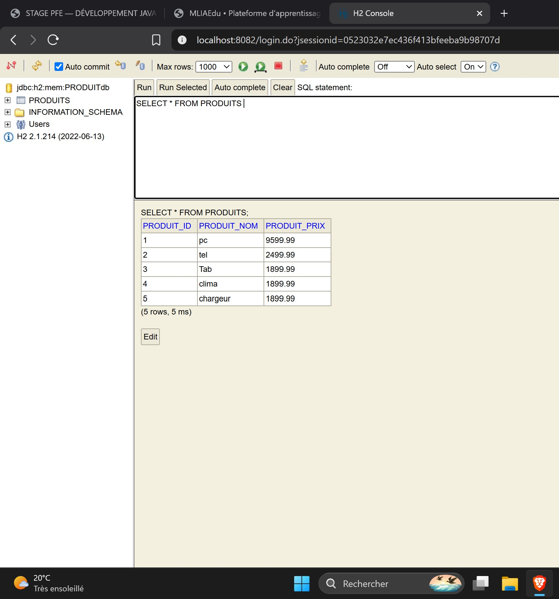
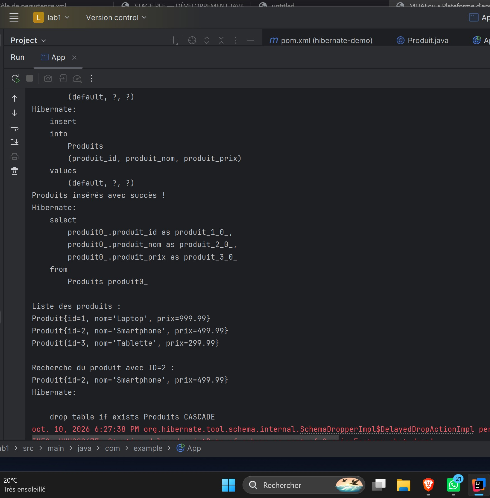

# Lab1 — Hibernate et H2

## Console H2

La console H2 affiche les cinq produits enregistrés dans la table PRODUITS.
Chaque produit possède un identifiant, un nom et un prix.

## Exécution de l’application

Hibernate insère les produits et affiche leur liste dans la console.
L’application recherche ensuite le produit dont l’identifiant est 2.
